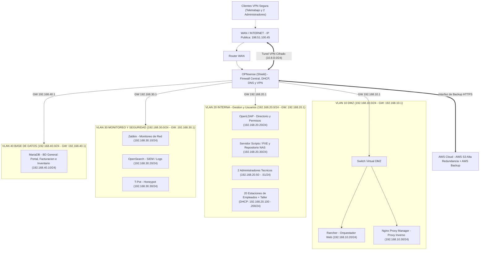

# 2. Diseño de la Infraestructura Tecnológica

## 2.1. Diagrama de la infraestructura

El siguiente diagrama representa de forma completa la topología lógica y física del proyecto para **Distributions-Líder**: el acceso a **Internet / WAN**, el **Router** perimetral, el cortafuegos central **OPNsense (Shield)**, el túnel **VPN seguro**, la conexión de respaldo con **AWS Cloud (AWS S3 / AWS Backup)** y la segmentación en **cuatro zonas lógicas (VLAN 10, VLAN 20, VLAN 30 y VLAN 40)** con todos sus servidores, servicios, estaciones de usuarios y direcciones IPv4:

### Esquema complementario de flujos y arquitectura de red

---

## 2.2. Descripción y justificación de la infraestructura

La arquitectura se ha diseñado bajo el principio de **defensa en profundidad y mínimo privilegio**, centralizando todo el enrutamiento y control de tráfico en el cortafuegos **OPNsense (Shield)**, que divide la red en cuatro VLANs aisladas según su nivel de exposición y criticidad:

### 1. Redes o zonas lógicas (VLANs) y su justificación

* **VLAN 10 — DMZ (`192.168.10.0/24`):** Zona desmilitarizada que aloja exclusivamente los servicios expuestos a Internet (el portal web de pedidos y consulta de reparaciones).
  * *Justificación:* Si un atacante externo compromete el frontal web público, el firewall impide que pueda saltar a los equipos de los empleados (`VLAN 20`) o a la consola de seguridad (`VLAN 30`).
* **VLAN 20 — INTERNA (`192.168.20.0/24`):** Red corporativa que interconecta a los 20 empleados de los cuatro departamentos (Montaje, Almacén, Administración y Marketing), a los 2 administradores técnicos, al servidor de directorio y al servidor de despliegue por red.
  * *Justificación:* Agrupa la operativa interna bajo control de identidades (**OpenLDAP**) y automatiza la asignación IP (**DHCP**) y el arranque por red (**PXE**) para agilizar el trabajo del taller de reparaciones en la 1.ª planta.
* **VLAN 30 — MONITOREO Y SEGURIDAD (`192.168.30.0/24`):** Zona de gestión de seguridad y observabilidad que aloja el stack de monitorización, SIEM y detección de intrusiones.
  * *Justificación:* Mantener los registros de auditoría (**OpenSearch**), las alertas de disponibilidad (**Zabbix**) y el sistema de señuelos (**T-Pot**) en una VLAN independiente garantiza que un incidente en cualquier otra subred sea detectado de inmediato sin que los logs puedan ser alterados.
* **VLAN 40 — BASE DE DATOS (`192.168.40.0/24`):** Zona de alta protección que aloja el servidor de base de datos relacional (**MariaDB**), inaccesible directamente desde Internet.
  * *Justificación:* La base de datos concentra los activos más sensibles de **Distributions-Líder** (facturación, datos de clientes, inventario y pedidos web). Aislarla en su propia VLAN permite que OPNsense solo autorice consultas SQL estrictamente necesarias (puerto `3306/TCP`) desde el portal en la DMZ y desde las aplicaciones internas autorizadas.

### 2. Servidores, servicios principales y funciones

* **Rancher (`192.168.10.20`) y Nginx Proxy Manager (`192.168.10.30`) — VLAN 10:**
  * **Nginx Proxy Manager** actúa como punto único de entrada web desde Internet (proxy inverso HTTP/HTTPS con gestión de certificados SSL/TLS), redirigiendo las peticiones de los clientes hacia los contenedores de la aplicación web orquestados por **Rancher**.
* **OpenLDAP (`192.168.20.20`) — VLAN 20:**
  * Servicio de directorio centralizado que autentica a los 22 trabajadores y aplica políticas de control de acceso por grupos departamentales (`montaje`, `almacen`, `administracion`, `marketing`, `admins`).
* **Servidor de Scripts / PXE y Repositorio (`192.168.20.30`) — VLAN 20:**
  * Centraliza el almacenamiento compartido de imágenes ISO, manuales técnicos, scripts de post-instalación y el servicio de arranque por red (**PXE**), permitiendo al departamento de Montaje instalar sistemas operativos de forma simultánea y desatendida.
* **Stack de Monitoreo y Ciberseguridad — VLAN 30:**
  * **Zabbix (`192.168.30.10`):** Supervisa en tiempo real la disponibilidad, carga de CPU/RAM, estado de los discos RAID y tráfico de todos los servidores, switches y enlaces.
  * **OpenSearch (`192.168.30.20`):** Actúa como SIEM centralizando y correlacionando los logs del firewall OPNsense, de los contenedores web, de OpenLDAP y de MariaDB.
  * **T-Pot (`192.168.30.30`):** Plataforma *honeypot* que simula servicios vulnerables para atraer, registrar y alertar sobre escaneos o intentos de movimiento lateral en la red.
* **MariaDB (`192.168.40.10`) — VLAN 40:**
  * Motor de base de datos central que da soporte transaccional tanto al portal web de clientes (pedidos y estado de reparaciones) como a la gestión interna de inventario y facturación.

### 3. Dispositivos de red, conectividad física y servicios cloud

* **OPNsense (Shield):** Cortafuegos perimetral e inter-VLAN en rack. Es el núcleo de la red: actúa como puerta de enlace (*gateway*) de las cuatro VLANs (`192.168.10.1`, `.20.1`, `.30.1`, `.40.1`), proporciona los servicios básicos de red (**DHCP y DNS interno**), termina el túnel **VPN** para teletrabajo y administración remota y gestiona la interfaz dedicada de copias de seguridad hacia **AWS**.
* **Router WAN:** Dispositivo de borde del operador (fibra simétrica 1 Gbps) con IP pública fija `198.51.100.45`, que enlaza el puerto WAN de OPNsense con Internet.
* **Conmutación física y virtual:**
  * **Switch virtual DMZ:** Conmutador lógico del clúster de virtualización que une **Rancher** y **Nginx Proxy Manager** con la interfaz DMZ (`192.168.10.1`) de OPNsense.
  * **Switches gestionables por planta y Wi-Fi:** Tres switches L2/L3 de 24 puertos GbE PoE+ con enlaces troncales de fibra óptica SFP+ 10G (uno en Sótano, 1.ª planta y 2.ª planta), un switch de 16 puertos en la bancada del taller de Montaje y tres puntos de acceso Wi-Fi 6 empresariales (priorizando los lectores de inventario del almacén en el sótano).
* **Servicios Cloud (AWS S3 y AWS Backup):** Almacenamiento en la nube de alta redundancia conectado de forma cifrada con OPNsense para externalizar las copias de seguridad de **MariaDB**, configuraciones del sistema y documentación crítica fuera de las instalaciones del polígono PIBO.

---

## 2.3. Plan de direccionamiento IPv4

### 1. Tabla de redes y subredes IPv4

El diseño emplea direccionamiento privado `192.168.x.0/24` estructurado de forma correlativa según el identificador de VLAN (`VLAN 10`, `20`, `30` y `40`), evitando cualquier solapamiento y facilitando la administración y lectura de reglas en el firewall:

| Red / Zona | Dirección de red | Máscara (CIDR) | Rango útil de hosts | Broadcast | Gateway (OPNsense) | Uso principal |
| :--- | :--- | :--- | :--- | :--- | :--- | :--- |
| **WAN / Internet** | `198.51.100.0` | `255.255.255.0 (/24)` | `198.51.100.1 – .254` | `198.51.100.255` | `198.51.100.1` (ISP) | Enlace público del Router WAN (`198.51.100.45`). |
| **VLAN 10 DMZ** | `192.168.10.0` | `255.255.255.0 (/24)` | `192.168.10.1 – .254` | `192.168.10.255` | `192.168.10.1` | Publicación aislada del portal web para clientes. |
| **VLAN 20 INTERNA** | `192.168.20.0` | `255.255.255.0 (/24)` | `192.168.20.1 – .254` | `192.168.20.255` | `192.168.20.1` | Usuarios, departamentos, LDAP, PXE/NAS y DHCP. |
| **VLAN 30 MONITOREO** | `192.168.30.0` | `255.255.255.0 (/24)` | `192.168.30.1 – .254` | `192.168.30.255` | `192.168.30.1` | Supervisión de red, SIEM de logs y honeypot. |
| **VLAN 40 BD** | `192.168.40.0` | `255.255.255.0 (/24)` | `192.168.40.1 – .254` | `192.168.40.255` | `192.168.40.1` | Aislamiento estricto de la base de datos MariaDB. |
| **Túnel VPN** | `10.8.0.0` | `255.255.255.0 (/24)` | `10.8.0.1 – .254` | `10.8.0.255` | `10.8.0.1` | Acceso remoto seguro (teletrabajo y administradores). |

### 2. Asignación de direcciones IP fijas y rangos dinámicos (DHCP)

Todos los dispositivos de red y servidores cuentan con **dirección IPv4 estática** fuera del ámbito DHCP para garantizar la estabilidad de los servicios y de las reglas del cortafuegos:

| Dispositivo / Servidor | Red / Zona | Dirección IP | Máscara | Gateway | Función y observaciones |
| :--- | :--- | :--- | :--- | :--- | :--- |
| **OPNsense — Interfaz WAN** | WAN | `198.51.100.45` | `/24` | `198.51.100.1` | IP pública WAN para portal web, VPN y enlace AWS Backup. |
| **OPNsense — Gateways LAN** | VLAN 10/20/30/40 | `192.168.10.1` `192.168.20.1` `192.168.30.1` `192.168.40.1` | `/24` | `198.51.100.45` | Puertas de enlace de cada VLAN, servidor DHCP y DNS interno. |
| **Rancher** | VLAN 10 DMZ | `192.168.10.20` | `/24` | `192.168.10.1` | Orquestador de contenedores del portal web (IP fija). |
| **Nginx Proxy Manager** | VLAN 10 DMZ | `192.168.10.30` | `/24` | `192.168.10.1` | Proxy inverso expuesto a Internet por NAT (`80/443 TCP`). |
| **OpenLDAP (Directorio)** | VLAN 20 INTERNA | `192.168.20.20` | `/24` | `192.168.20.1` | Autenticación centralizada y permisos departamentales (IP fija). |
| **Servidor Scripts / PXE / NAS** | VLAN 20 INTERNA | `192.168.20.30` | `/24` | `192.168.20.1` | Repositorio compartido (ISOs/manuales) y arranque PXE (IP fija). |
| **Equipos de Administradores IT** | VLAN 20 INTERNA | `192.168.20.50 – .51` | `/24` | `192.168.20.1` | Reserva DHCP estática para los 2 administradores técnicos. |
| **Estaciones de trabajo y Taller** | VLAN 20 INTERNA | `192.168.20.100 – .200` | `/24` | `192.168.20.1` | Ámbito DHCP dinámico para los 20 empleados y equipos en reparación. |
| **Zabbix** | VLAN 30 MONITOREO | `192.168.30.10` | `/24` | `192.168.30.1` | Servidor de monitorización de infraestructura y red (IP fija). |
| **OpenSearch** | VLAN 30 MONITOREO | `192.168.30.20` | `/24` | `192.168.30.1` | Centralización y correlación de logs / SIEM (IP fija). |
| **T-Pot** | VLAN 30 MONITOREO | `192.168.30.30` | `/24` | `192.168.30.1` | Honeypot de detección temprana de intrusiones (IP fija). |
| **MariaDB** | VLAN 40 BD | `192.168.40.10` | `/24` | `192.168.40.1` | Base de datos general del portal web, inventario y facturación (IP fija). |

### 3. Aspectos básicos que deben comprobarse en la configuración

Para validar que el plan de direccionamiento IPv4 y la segmentación funcionan sin errores ni conflictos, deben ejecutarse las siguientes comprobaciones técnicas:

| Aspecto a comprobar | Prueba / Verificación técnica | Resultado esperado |
| :--- | :--- | :--- |
| **1. Ausencia de conflictos y conectividad a Gateways** | Ejecutar `arping` y `ping` desde cada servidor hacia el gateway de su VLAN (`192.168.10.1`, `.20.1`, `.30.1` y `.40.1`). | Respuesta `0% packet loss`, sin IPs duplicadas y tablas ARP/MAC coherentes en los switches y en OPNsense. |
| **2. Servicio DHCP y DNS interno (VLAN 20)** | Conectar una estación de empleado y un equipo en la bancada de taller en modo automático (`dhclient` / `ipconfig /renew`) y consultar `nslookup`. | El cliente recibe IP en el rango `192.168.20.100–.200/24`, gateway `192.168.20.1`, DNS `192.168.20.1` y resuelve dominios internos y externos. |
| **3. Aislamiento estricto de la DMZ (VLAN 10)** | Intentar conexiones desde `192.168.10.20/.30` hacia `192.168.20.0/24` (Interna), `192.168.30.0/24` (Monitoreo) y hacia el puerto `3306` de `192.168.40.10` (MariaDB). | Tráfico **bloqueado** por OPNsense hacia VLAN 20 y VLAN 30; tráfico **permitido únicamente** hacia `192.168.40.10:3306` (MariaDB). |
| **4. Servicios internos: LDAP, PXE y Base de Datos** | Probar autenticación de usuario en **OpenLDAP** (`192.168.20.20:389/636`), arranque en red **PXE** contra `192.168.20.30` y consulta de facturación a **MariaDB** (`192.168.40.10`). | Autenticación y permisos departamentales correctos, descarga de imagen PXE a 1/10 Gbps y acceso a MariaDB solo desde equipos autorizados. |
| **5. Supervisión y recolección de logs (VLAN 30)** | Comprobar en **Zabbix** (`192.168.30.10`) el estado de los agentes/SNMP de todas las VLANs y verificar la recepción de eventos en **OpenSearch** (`192.168.30.20`). | Todos los servidores aparecen activos (*Up*), los logs del firewall se indexan en tiempo real y el honeypot **T-Pot** (`192.168.30.30`) registra intentos de conexión no autorizados. |
| **6. Publicación web, NAT, VPN y Backup Cloud** | Acceder desde el exterior a `https://198.51.100.45`, conectar un cliente **VPN** (`10.8.0.0/24`) y lanzar una tarea de copia en **AWS Backup / AWS S3**. | El tráfico externo solo alcanza **Nginx Proxy Manager** (`192.168.10.30:443`), la VPN autentica correctamente y el respaldo en AWS S3 finaliza con éxito. |
