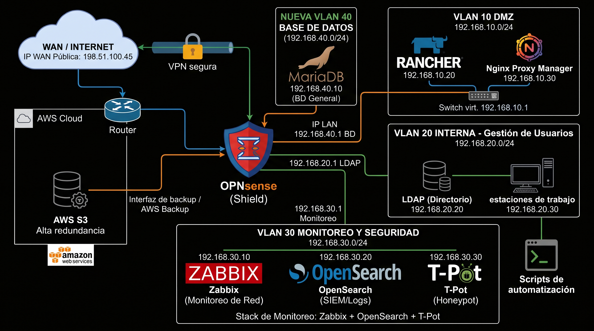

# 1. Necesidad

La empresa **Distributions-Líder**, ubicada en el polígono PIBO y dedicada a la distribución y reparación de equipos informáticos para pymes, requiere una infraestructura de red segura para su edificio de dos plantas y sótano. Con 20 empleados distribuidos en cuatro departamentos (Montaje y Reparaciones, Almacén y Logística, Administración y Marketing) y 2 administradores técnicos, necesita compartir recursos internos de forma fluida (inventarios, facturas, ISOs), automatizar despliegues por red (PXE) y ofrecer un portal web externo para clientes respaldado mediante copias de seguridad en la nube.

# 2. Trabajo práctico

## 2.1. Propuesta de infraestructura

La infraestructura se segmenta mediante un firewall central (**OPNsense**) en cuatro zonas lógicas:

*   **Redes o zonas (VLANs):**
    *   **VLAN 10 DMZ:** Aloja y aísla el portal web público frente a la red interna.
    *   **VLAN 20 INTERNA:** Conecta a los empleados y administradores para compartir recursos corporativos.
    *   **VLAN 30 MONITOREO Y SEGURIDAD:** Red aislada para supervisar la disponibilidad y seguridad de los servidores.
    *   **VLAN 40 BASE DE DATOS:** Aislamiento estricto para proteger los datos corporativos y del portal web.

*   **Servidores y servicios principales:**
    *   **Rancher y Nginx Proxy Manager (VLAN 10):** Orquestan los contenedores de la aplicación web y gestionan el proxy inverso (SSL/TLS) para publicar de forma segura el portal de clientes.
    *   **OpenLDAP (VLAN 20):** Servicio de directorio centralizado para la gestión de usuarios, grupos, permisos y control de accesos por departamento.
    *   **Servidor de Automatización / Repositorio y Estaciones de trabajo (VLAN 20):** Servidor centralizado con scripts de automatización, imágenes ISO, manuales y despliegue de sistemas operativos por red (PXE), junto con los equipos de los empleados y administradores.
    *   **Stack de Monitoreo - Zabbix, OpenSearch y T-Pot (VLAN 30):** Supervisa el estado y disponibilidad de la red, centraliza el análisis de logs (SIEM) y detecta ataques mediante señuelos (*honeypot*).
    *   **MariaDB (VLAN 40):** Base de datos general que respalda el portal web, la facturación y el inventario.

*   **Dispositivos de red:**
    *   **OPNsense (Shield):** Firewall perimetral e inter-VLAN que filtra el tráfico, asigna IPs dinámicas (DHCP), proporciona resolución de nombres interna (DNS), gestiona el túnel VPN y conecta la interfaz de backup hacia AWS.
    *   **Router WAN:** Enlace principal entre el firewall OPNsense e Internet (IP pública `198.51.100.45`).
    *   **Switch virtual:** Conmutador lógico en la DMZ para interconectar Rancher y Nginx Proxy Manager con la interfaz del firewall.

*   **Operativa y accesibilidad:**
    *   **Ubicación física:** Sótano (4 empleados de Almacén), 1.ª planta (8 empleados de Montaje) y 2.ª planta (8 empleados de Administración y Marketing), junto con 2 administradores técnicos operando en la VLAN 20.
    *   **Accesibilidad externa y VPN:** Desde Internet solo son accesibles el portal web (vía Nginx) y la VPN segura en OPNsense para teletrabajo y administración remota.
    *   **Servicios Cloud (AWS S3):** Almacenamiento externo de alta redundancia conectado a OPNsense para copias de seguridad.

## 2.2. Diagrama de la infraestructura

El siguiente esquema representa la topología lógica, el direccionamiento y las conexiones entre las cuatro VLANs, el firewall OPNsense, Internet y AWS Cloud:

## 2.3. Plan de direccionamiento IPv4

Direccionamiento base de las redes definidas:

| Red / Zona | Dirección de red | Máscara | Gateway | Observaciones |
| :--- | :--- | :--- | :--- | :--- |
| **VLAN 10 DMZ** | 192.168.10.0 | 255.255.255.0 (/24) | 192.168.10.1 | Portal web público para clientes (IPs fijas). |
| **VLAN 20 INTERNA** | 192.168.20.0 | 255.255.255.0 (/24) | 192.168.20.1 | Gestión de usuarios, departamentos y DHCP (`192.168.20.100` – `192.168.20.200`). |
| **VLAN 30 MONITOREO** | 192.168.30.0 | 255.255.255.0 (/24) | 192.168.30.1 | Supervisión y seguridad de red (IPs fijas). |
| **VLAN 40 BD** | 192.168.40.0 | 255.255.255.0 (/24) | 192.168.40.1 | Aislamiento de base de datos general (IP fija). |

Dispositivos de infraestructura, servidores con dirección IP fija y rangos dinámicos:

| Dispositivo / Servidor | Red / Zona | Dirección IP / Máscara | Gateway | Observaciones |
| :--- | :--- | :--- | :--- | :--- |
| **OPNsense (Shield)** | Todas / WAN | 192.168.x.1 /24 (LANs) 198.51.100.45 (WAN) | Router WAN | Firewall central, gateways de cada VLAN, DHCP, DNS, VPN y enlace AWS Backup. |
| **Rancher** | VLAN 10 | 192.168.10.20 /24 | 192.168.10.1 | Orquestador de contenedores del portal web. |
| **Nginx Proxy Manager** | VLAN 10 | 192.168.10.30 /24 | 192.168.10.1 | Proxy inverso expuesto a Internet (puertos 80/443). |
| **LDAP (Directorio)** | VLAN 20 | 192.168.20.20 /24 | 192.168.20.1 | Control centralizado de usuarios y permisos departamentales. |
| **Servidor Scripts / PXE** | VLAN 20 | 192.168.20.30 /24 | 192.168.20.1 | Repositorio compartido (ISOs/manuales), scripts y despliegue PXE. |
| **Estaciones de trabajo** | VLAN 20 | 192.168.20.100 – .200 /24 | 192.168.20.1 | Rango DHCP para los 20 empleados, 2 administradores y bancada de taller. |
| **Zabbix** | VLAN 30 | 192.168.30.10 /24 | 192.168.30.1 | Monitoreo de disponibilidad y estado de la red. |
| **OpenSearch** | VLAN 30 | 192.168.30.20 /24 | 192.168.30.1 | Centralización y análisis de logs (SIEM). |
| **T-Pot** | VLAN 30 | 192.168.30.30 /24 | 192.168.30.1 | Honeypot para detección temprana de ataques. |
| **MariaDB** | VLAN 40 | 192.168.40.10 /24 | 192.168.40.1 | Base de datos general (portal web, inventario y facturación). |

**Aspectos básicos que deben comprobarse en la configuración de red:**

1. **Conectividad local y puertas de enlace:** Verificar mediante `ping` que cada servidor y estación alcanza su respectivo gateway en OPNsense (`192.168.10.1`, `192.168.20.1`, `192.168.30.1` y `192.168.40.1`) sin conflictos de IP.
2. **Servicios básicos DHCP y DNS (VLAN 20):** Comprobar que los equipos de empleados y del taller de reparaciones reciben automáticamente una IP dentro del rango `192.168.20.100 – 192.168.20.200`, su máscara `/24`, el gateway `192.168.20.1` y resuelven nombres internos y externos.
3. **Aislamiento y filtrado inter-VLAN:**
   * Confirmar que la **VLAN 10 (DMZ)** solo puede comunicarse con **MariaDB** (`192.168.40.10`, puerto 3306) y tiene bloqueado cualquier inicio de conexión hacia la **VLAN 20 (Interna)** y la **VLAN 30 (Monitoreo)**.
   * Verificar que la **VLAN 20** puede autenticar contra **LDAP** (`192.168.20.20`), arrancar por red desde el servidor **PXE** (`192.168.20.30`) y consultar **MariaDB** según los permisos departamentales.
   * Comprobar que el stack de **VLAN 30** (**Zabbix** y **OpenSearch**) recibe métricas y logs de todas las zonas sin permitir tráfico inverso no autorizado.
4. **Acceso externo, NAT y servicios remotos:** Validar la salida a Internet desde las redes autorizadas (NAT), la accesibilidad externa exclusiva al portal web a través de **Nginx Proxy Manager** (`192.168.10.30`), el establecimiento del túnel **VPN** en OPNsense y la conexión de respaldo hacia **AWS S3 / AWS Backup**.
