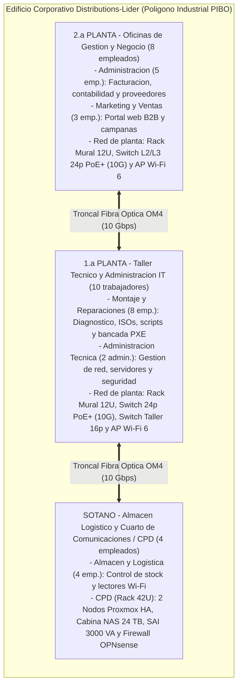

# Proyecto de Infraestructura Tecnológica: Distributions-Líder

## 1.1. Definición de la empresa

**Distributions-Líder** es una pequeña empresa tecnológica dedicada a la distribución, ensamblaje a medida y reparación de equipos microinformáticos y servidores para pymes. Su propuesta de valor destaca por su alta flexibilidad, la optatividad de sistemas operativos (Linux y Windows), el despliegue rápido de equipos preconfigurados y la creación de optimizaciones adaptadas a cada sector empresarial.

* **Ubicación e instalaciones:** La empresa se sitúa en el **Polígono Industrial PIBO** (Bollullos de la Mitación, Sevilla), un enclave estratégico con excelente conexión logística y de telecomunicaciones que concentra numerosas pequeñas y medianas empresas. Opera en un edificio corporativo distribuido en **tres niveles**: primera planta (taller técnico), segunda planta (oficinas de gestión y negocio) y sótano (almacén logístico y cuarto de comunicaciones/CPD).
* **Perfil de clientes:** Sus clientes principales son pequeñas y medianas empresas de tres perfiles:
  1. Tiendas de informática que adquieren lotes de equipos para su reventa.
  2. Negocios de hostelería y comercio que requieren terminales y configuraciones específicas listas para operar.
  3. Medianas empresas que demandan servidores, estaciones de trabajo y soporte para digitalizar y administrar sus procesos.
* **Finalidad del proyecto:** Diseñar, dimensionar y presupuestar una infraestructura de red corporativa segura, segmentada en VLANs y de alta disponibilidad que interconecte las tres plantas del edificio, centralice la gestión de usuarios y archivos, automatice la instalación masiva de sistemas operativos por red (PXE) en el taller, monitorice la ciberseguridad de los sistemas y publique de forma segura un nuevo portal web de pedidos e incidencias respaldado en la nube (**AWS S3**).

## 1.2. Organización y contexto de la empresa

La plantilla de **Distributions-Líder** está integrada por **20 empleados** repartidos en cuatro departamentos operativos, a los que se suman **2 administradores técnicos de sistemas** (22 trabajadores en total) encargados de implantar, administrar y mantener la infraestructura tecnológica.

La organización física por plantas, departamentos y el uso diario de los recursos informáticos se estructura del siguiente modo:

| Departamento / Rol | Ubicación física | Nº de trabajadores | Uso de los recursos informáticos y de red |
| :--- | :--- | :---: | :--- |
| **Montaje y Reparaciones** | Primera planta | 8 | Diagnóstico y reparación de equipos de clientes, descarga de imágenes de sistemas operativos (ISOs), ejecución de scripts de optimización, consulta de manuales técnicos e instalación automatizada por red (**PXE**). |
| **Administración Técnica (IT)** | Primera planta / CPD | 2 | Gestión del firewall **OPNsense**, administración del directorio **OpenLDAP**, mantenimiento del clúster de virtualización, supervisión del SIEM/monitoreo (**Zabbix, OpenSearch, T-Pot**), copias de seguridad y acceso remoto **VPN**. |
| **Almacén y Logística** | Sótano | 4 | Control de stock de componentes y servidores, registro de entradas/salidas con terminales y lectores conectados por Wi-Fi/LAN y actualización en tiempo real de la base de datos de inventario. |
| **Administración** | Segunda planta | 5 | Facturación, contabilidad, gestión de compras a proveedores, control de presupuestos y administración de contratos con empresas clientes. |
| **Marketing y Ventas** | Segunda planta | 3 | Gestión comercial del portal web de clientes, campañas publicitarias, atención a pedidos B2B y comunicación con pymes. |
| **Total plantilla** | **3 niveles (Sótano, 1.ª y 2.ª)** | **22** | **Trabajo colaborativo interdepartamental sobre red segmentada y servicios centralizados.** |

Los departamentos requieren compartir información crítica de forma fluida pero controlada: **Almacén** y **Montaje** sincronizan continuamente el stock de piezas para las reparaciones y ensamblajes, mientras que **Marketing** y **Montaje** trasladan los pedidos y partes de trabajo a **Administración** para su facturación. Al mismo tiempo, la empresa necesita ofrecer a sus clientes empresariales un **portal web externo (24/7)** donde puedan comprar equipamiento, solicitar servidores a medida y consultar en tiempo real el estado de reparación de sus equipos.

## 1.3. Análisis de las necesidades tecnológicas

En la siguiente tabla se analiza de forma concreta cómo responde cada una de las **12 necesidades tecnológicas** a la operativa real de **Distributions-Líder** y qué solución técnica se adopta en la infraestructura:

| Necesidad técnica | Utilidad concreta en Distributions-Líder | Solución adoptada en el diseño |
| :--- | :--- | :--- |
| **1. Separación de servicios accesibles desde Internet y red interna** | Aislar el portal público de ventas y seguimiento de reparaciones frente a la red interna de oficinas y taller para que una intrusión web no alcance los equipos corporativos. | Segmentación en **VLAN 10 (DMZ)** para el portal web, separada de la **VLAN 20 (Interna)** y la **VLAN 40 (BD)** mediante **OPNsense**. |
| **2. Ciberseguridad, protección de sistemas y control del tráfico** | Proteger los datos de facturación y clientes y evitar que ordenadores de terceros infectados que entran al taller de reparación propaguen malware por la red. | Cortafuegos **OPNsense (Shield)** con filtrado inter-VLAN, SIEM **OpenSearch** y honeypot **T-Pot** en **VLAN 30**. |
| **3. Servicios básicos de red (DNS y DHCP)** | Asignar configuración IP automática a los 22 puestos de trabajo y a los equipos en bancada de reparación, además de resolver nombres de servidores internos. | Servidor **DHCP** (rango `192.168.20.100–.200`) y **DNS interno** integrados y centralizados en **OPNsense**. |
| **4. Gestión centralizada de usuarios, grupos, permisos y accesos** | Garantizar que cada empleado acceda solo a los recursos de su área (facturación en Administración, campañas en Marketing, imágenes PXE en Montaje, stock en Almacén). | Servidor de directorio **OpenLDAP** (`192.168.20.20`) en la **VLAN 20** con grupos por departamento. |
| **5. Almacenamiento compartido** | Disponer de un repositorio centralizado de alta velocidad (10GbE) donde guardar y compartir ISOs, scripts de optimización, manuales técnicos y documentación. | Cabina **NAS RAID 5 (24 TB)** y servidor repositorio (`192.168.20.30`) accesible por permisos departamentales. |
| **6. Aplicación web con base de datos** | Ofrecer a las pymes clientes un portal web para encargar servidores, comprar lotes de equipos y consultar el estado de sus incidencias, conectado a la base de datos de negocio. | Portal web en contenedores (**Rancher + Nginx Proxy Manager** en VLAN 10) conectado a **MariaDB** (`192.168.40.10` en VLAN 40). |
| **7. Acceso remoto seguro mediante VPN** | Permitir el teletrabajo seguro a los empleados de oficina y la administración remota de los servidores fuera de horario a los 2 administradores técnicos. | Servidor **VPN seguro** en **OPNsense** con autenticación cifrada desde Internet (`198.51.100.45`). |
| **8. Copias de seguridad y recuperación de información** | Respaldar la base de datos de facturación, inventario, configuraciones de clientes y máquinas virtuales para garantizar la continuidad del negocio ante fallos o ransomware. | Copias locales en **NAS** y respaldo externo automatizado mediante **AWS Backup** desde OPNsense. |
| **9. Monitorización de la infraestructura** | Supervisar en tiempo real el consumo, estado de los servidores, tráfico de red y disponibilidad del portal web para anticipar caídas del servicio. | Stack de monitoreo en **VLAN 30**: **Zabbix** (`192.168.30.10`) para métricas y **OpenSearch** (`192.168.30.20`) para logs. |
| **10. Automatización de tareas de administración** | Automatizar el despliegue de sistemas operativos y configuraciones base por red en la bancada del taller, ahorrando horas de instalación manual en cada pedido. | Servidor de despliegue en red **PXE y Scripts de automatización** (`192.168.20.30`) en la **VLAN 20**. |
| **11. Servicios o recursos cloud** | Contar con almacenamiento externo georredundante fuera de la nave del polígono PIBO para proteger las copias de seguridad críticas frente a siniestros físicos. | Almacenamiento **AWS S3 de alta redundancia** integrado con **AWS Backup**. |
| **12. Mantenimiento de servicios y resolución de incidencias** | Mantener la red operativa sin interrupciones en taller, almacén y oficinas, resolviendo incidencias de hardware, red o software con rapidez. | **2 Administradores Técnicos** en plantilla apoyados en un clúster **Proxmox VE en alta disponibilidad (HA)** y monitorización activa. |
