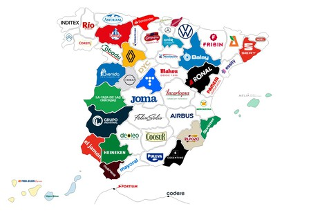

# Proyecto de Infraestructura Tecnológica: Distributions-líder

## 1a. Presentación de la empresa

Distributions-líder es una pequeña empresa dedicada a la distribución y reparación de equipos microinformáticos, destacando por su gran flexibilidad, optatividad de sistemas operativos y la creación de optimizaciones y configuraciones propias.

La empresa se encuentra ubicada en el polígono PIBO, una zona que concentra mayormente a medianas y pequeñas empresas, contando con una excelente ubicación para la comunicación e interconexión con clientes y proveedores. Sus principales clientes son pequeñas y medianas empresas: desde tiendas de informática que buscan la reventa de equipos, hasta negocios de hostelería que requieren configuraciones específicas para facilitar el trabajo de sus empleados, o medianas empresas que demandan servidores y equipos para digitalizar y administrar sus sistemas.

Sus instalaciones se distribuyen en un edificio de dos plantas donde se ubican los diferentes departamentos, además de contar con un sótano destinado a las tareas de almacén para guardar los productos.

## 1b. Organización y contexto de la empresa

La empresa cuenta con 20 empleados, y para este proyecto se contempla la incorporación de 2 puestos de administración técnica encargados de desplegar y mantener la infraestructura informática. Los empleados están distribuidos en cuatro departamentos organizados físicamente en el edificio:

| Departamento | Ubicación | Nº de empleados (Aprox.) |
| :--- | :--- | :--- |
| **Montaje y Reparaciones** | Primera planta | 8 |
| **Almacén y Logística** | Sótano | 4 |
| **Administración** | Segunda planta | 5 |
| **Marketing** | Segunda planta | 3 |

Los trabajadores de la primera planta y el sótano utilizan la red para gestionar el inventario, descargar imágenes de sistemas operativos (ISOs) y manuales técnicos para las configuraciones de los clientes. En la segunda planta, Administración y Marketing utilizan los equipos para la gestión de clientes, facturación, proveedores y campañas publicitarias.

Los departamentos necesitan compartir información de forma fluida (por ejemplo, el inventario entre Almacén y Montaje, o las facturas de ventas con Administración). Además, Distributions-líder necesita proporcionar un portal web para que sus clientes empresariales puedan realizar pedidos, solicitar servidores o consultar el estado de la reparación de sus equipos informáticos.

## 1c. Análisis de las necesidades tecnológicas

| Necesidad técnica | Utilidad en la empresa |
| :--- | :--- |
| **1. Separación de servicios accesibles desde Internet y red interna** | Mantener el portal web de ventas y seguimiento separado de la red de montaje, pruebas y administración interna. |
| **2. Ciberseguridad, protección de sistemas y control del tráfico** | Proteger los datos de facturación de las empresas clientes y aislar los equipos de pruebas para evitar infecciones en la red principal. |
| **3. Servicios básicos de red (DNS y DHCP)** | Asignar direcciones IP de forma dinámica a los equipos de los empleados y a los múltiples dispositivos de la zona de reparaciones. |
| **4. Gestión centralizada de usuarios, grupos, permisos y accesos** | Controlar qué empleados tienen acceso a la facturación (Administración), a las redes (Marketing) o al software de despliegue (Montajes). |
| **5. Almacenamiento compartido** | Disponer de un repositorio centralizado para compartir ISOs, scripts de optimización, manuales de reparación y documentos. |
| **6. Aplicación web con base de datos** | Ofrecer a las pymes clientes un portal para comprar equipos, encargar servidores o consultar el estado de sus incidencias. |
| **7. Acceso remoto seguro mediante VPN** | Permitir el teletrabajo a empleados y facilitar la gestión remota de servidores a los administradores de sistemas. |
| **8. Copias de seguridad y recuperación de información** | Proteger las configuraciones de los clientes, el inventario y la contabilidad frente a fallos de hardware o ataques. |
| **9. Monitorización de la infraestructura** | Controlar el estado de los servidores y la disponibilidad del portal de clientes para evitar caídas del servicio. |
| **10. Automatización de tareas de administración** | Automatizar la instalación de sistemas operativos por red (PXE) en los equipos nuevos, ahorrando tiempo en montaje. |
| **11. Servicios o recursos cloud** | Mantener una copia de seguridad externa de la información crítica de la empresa y bases de datos. |
| **12. Mantenimiento de servicios y resolución de incidencias** | Garantizar el correcto funcionamiento de la red en montaje y oficinas para no retrasar la entrega de equipos. |

